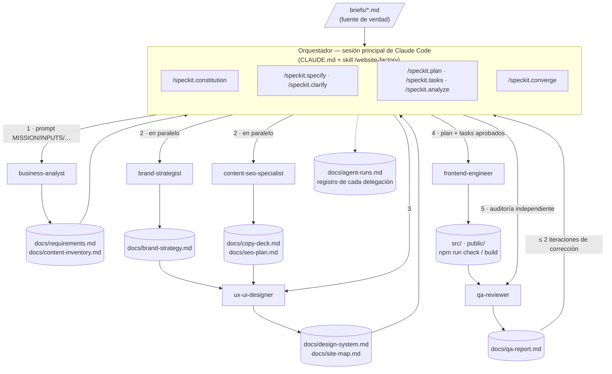

# Website Factory: un enjambre de agentes que convierte un brief en un sitio web

Este repositorio muestra un ejemplo completo de **programación agéntica**: un orquestador de [Claude Code](https://docs.claude.com/en/docs/claude-code) coordina **seis subagentes especializados** y el flujo **Spec-Driven Development** de [GitHub Spec Kit](https://github.com/github/spec-kit). Con ellos transforma un brief corto de una empresa en un sitio institucional **Astro + Tailwind CSS 4** que compila, pasa las pruebas y deja trazabilidad de cada decisión.

El repo contiene la fábrica (reglas, agentes, skills) y también **el resultado de una ejecución real**: specs, documentación intermedia, registro de agentes, reporte de QA y el sitio generado.

> **Caso de demostración:** el sitio de ejemplo pertenece a *Supermercado Los Álamos*, un **comercio ficticio**. Nombre, dirección (`Calle Ejemplo 123, Villa Ejemplo`) y teléfono (`0000 00-0000`) son inventados. En la documentación, `VERIFIED` significa "verificado contra el brief", no contra un comercio real.

---

## Índice

1. [La idea](#la-idea)
2. [Cómo funciona el enjambre](#cómo-funciona-el-enjambre)
3. [Los agentes](#los-agentes)
4. [El flujo paso a paso](#el-flujo-paso-a-paso)
5. [Mecanismos de control](#mecanismos-de-control)
6. [Trazabilidad: del brief al código](#trazabilidad-del-brief-al-código)
7. [Probarlo](#probarlo)
8. [Estructura del repositorio](#estructura-del-repositorio)
9. [Limitaciones](#limitaciones)

---

## La idea

Un solo agente que "hace una web" tiende a inventar contenido (reseñas, cifras, clientes), a mezclar decisiones de negocio con decisiones de CSS y a no dejar evidencia de por qué hizo lo que hizo. La fábrica ataca esos tres problemas así:

| Problema | Solución en este repo |
|---|---|
| Alucinación de datos comerciales | **El brief es la fuente de verdad.** Cada dato se etiqueta como `VERIFIED`, `ASSUMPTION`, `PLACEHOLDER` o `BLOCKED`, y un validador estático busca contenido fabricado. |
| Un agente generalista que decide todo | **Especialización**: seis roles con herramientas y archivos de salida acotados. |
| Falta de trazabilidad | **SDD con Spec Kit**: constitución → spec → plan → tareas → implementación → convergencia, con IDs (`REQ-xxx`, `FR-xxx`, `Txxx`) que conectan brief, documentación y código. |

---

## Cómo funciona el enjambre

La topología es **orquestador + especialistas** (hub-and-spoke). Los subagentes no se comunican entre sí: se coordinan **a través de archivos**. Cada uno lee los artefactos que produjeron los anteriores y escribe solo los suyos.



Ideas clave del diseño:

- **Un solo orquestador.** Solo la sesión principal decide prioridades, permisos, reintentos y el resultado final. Los subagentes **no pueden crear otros agentes** ni modificar las reglas superiores (`CLAUDE.md`, `.specify/`, prompts de otros agentes).
- **Propiedad exclusiva de archivos.** Cada agente tiene declarados sus `Outputs`. Por eso `brand-strategist` y `content-seo-specialist` pueden trabajar **en paralelo** sin pisarse. Las ediciones de un mismo archivo se serializan.
- **Mínimo privilegio.** Los cuatro agentes de análisis y diseño solo tienen `Read, Grep, Glob, Write`: no pueden ejecutar comandos. Solo `frontend-engineer` (que compila) y `qa-reviewer` (que verifica) tienen `Bash`.
- **Prompts dinámicos con contrato.** El orquestador no reutiliza un prompt fijo. Por cada delegación genera uno con seis secciones obligatorias:

  ```text
  MISSION:          responsabilidad concreta
  INPUTS:           rutas exactas (brief, spec, docs previos)
  OUTPUT FILES:     rutas de las que el agente es dueño
  ACCEPTANCE:       criterios medibles, con REQ-ID
  CONSTRAINTS:      stack, hechos verificados, prohibiciones
  STOP CONDITIONS:  cuándo detenerse y devolver el control
  ```

- **Las skills de Spec Kit las invoca el orquestador**, no los agentes. Que un agente "escriba una spec" no equivale a ejecutar `/speckit.specify`; la regla está explícita en `CLAUDE.md`.

---

## Los agentes

Definidos en [`.claude/agents/`](.claude/agents/), cada uno con frontmatter (`name`, `description`, `tools`, `model`) y secciones de Rol, Responsabilidad, Inputs, Outputs y Restricciones.

| Agente | Responsabilidad | Herramientas | Escribe |
|---|---|---|---|
| **business-analyst** | Convierte el brief en requisitos `REQ-001..n` con criterios Given/When/Then, mapa del sitio, supuestos y bloqueos. Clasifica cada dato (VERIFIED / ASSUMPTION / PLACEHOLDER / BLOCKED). | Read, Grep, Glob, Write | `docs/requirements.md`, `docs/content-inventory.md` |
| **brand-strategist** | Posicionamiento, tono de voz, mensajes por sección, dirección visual y guía de imágenes, sin inventar trayectoria ni premios. | Read, Grep, Glob, Write | `docs/brand-strategy.md` |
| **content-seo-specialist** | Copy final con IDs estables por sección (`HOME-S1-SUB`, `CONT-S2-MAP-TITLE`…), plan SEO local, títulos, descripciones, OG y JSON-LD estricto. | Read, Grep, Glob, Write | `docs/copy-deck.md`, `docs/seo-plan.md` |
| **ux-ui-designer** | Tokens `@theme`, tipografía, componentes con props, responsive 360/768/1440, estados de foco y wireframes. | Read, Grep, Glob, Write | `docs/design-system.md`, `docs/site-map.md` |
| **frontend-engineer** | Implementa las tareas de `tasks.md` en Astro + TypeScript + Tailwind 4, con el contenido separado del diseño en `src/content/`. | Read, Grep, Glob, Write, Edit, **Bash** | `src/`, `public/`, `astro.config.mjs` |
| **qa-reviewer** | Auditoría independiente brief ↔ spec ↔ diseño ↔ código: accesibilidad, SEO, contenido fabricado, checks y build. Clasifica hallazgos BLOCKER / MAJOR / MINOR. | Read, Grep, Glob, **Bash**, Write | `docs/qa-report.md` |

---

## El flujo paso a paso

La skill [`/website-factory`](.claude/skills/website-factory/SKILL.md) codifica la secuencia obligatoria de [`CLAUDE.md`](CLAUDE.md):

| # | Paso | Quién | Artefacto |
|---|---|---|---|
| 1 | Leer brief y crear la **constitución** del proyecto (6 principios) | Orquestador → `/speckit.constitution` | `.specify/memory/constitution.md` |
| 2 | Requisitos, supuestos, mapa del sitio, aceptación | `business-analyst` | `docs/requirements.md`, `docs/content-inventory.md` |
| 3 | **Especificación** formal con historias y FR ↔ REQ | Orquestador → `/speckit.specify` (`/speckit.clarify` solo si hay bloqueos) | `specs/001-…/spec.md` |
| 4 | Marca **y** copy/SEO **en paralelo** | `brand-strategist` ‖ `content-seo-specialist` | `docs/brand-strategy.md`, `docs/copy-deck.md`, `docs/seo-plan.md` |
| 5 | Sistema de diseño y wireframes | `ux-ui-designer` | `docs/design-system.md`, `docs/site-map.md` |
| 6 | **Plan**, **tareas** y **análisis** de consistencia | Orquestador → `/speckit.plan`, `/speckit.tasks`, `/speckit.analyze` | `plan.md`, `research.md`, `data-model.md`, `contracts/`, `tasks.md` |
| 7 | Implementación | `frontend-engineer` (o `/speckit.implement`) | `src/`, `public/` |
| 8 | QA independiente + correcciones (máx. 2 iteraciones) + **convergencia** | `qa-reviewer` → orquestador → `/speckit.converge` | `docs/qa-report.md` |
| 9 | Entrega: ruta, URL de preview, validaciones y pendientes | Orquestador | `docs/agent-runs.md` |

El registro real de esta ejecución está en [`docs/agent-runs.md`](docs/agent-runs.md). Resultados:
`/speckit.analyze` → 0 CRITICAL; implementación → `astro check` 0/0/0 y 5 páginas generadas; QA → 0 BLOCKER, 0 MAJOR, 8 MINOR; `/speckit.converge` → convergido.

---

## Mecanismos de control

Un enjambre sin límites diverge. Estos son los frenos:

1. **Constitución** ([`.specify/memory/constitution.md`](.specify/memory/constitution.md)): seis principios no negociables (brief como fuente de verdad, stack fijo, contenido separado del diseño, accesibilidad, SEO local honesto, verificabilidad). `/speckit.plan` incluye un *Constitution Check* que tiene que pasar.
2. **Estados de los datos.** Ningún texto comercial llega al sitio sin estado. Por ejemplo, en [`src/content/site.ts`](src/content/site.ts) cada campo lleva su comentario (`// VERIFIED`, `// BRIEF-VALIDAR`, `// ASSUMPTION (A-04)`), y los canales sin confirmar (`email`, `whatsapp`…) tienen `value: null` y **no se renderizan**.
3. **Fuente única de datos.** Dirección, teléfono y horarios aparecen literalmente **en un solo archivo** (contrato C-01). Los componentes los consumen desde ahí.
4. **Estados vacíos honestos.** Si no hay ofertas confirmadas (`offers: []`), el sitio muestra un estado vacío; nunca precios de ejemplo.
5. **Quality gates** ([`docs/quality-gates.md`](docs/quality-gates.md)): `npm run check`, `npm run build` y [`scripts/validate_content.py`](scripts/validate_content.py), que busca secretos, dominios de ejemplo y contactos falsos en `src/`, verifica la invariante de fuente única (C-01) y controla patrones prohibidos y obligatorios en el HTML generado (C-03).
6. **Iteraciones acotadas.** Como máximo dos rondas de corrección por fallo; lo que no se resuelva queda como pendiente documentado.
7. **Sin acciones externas.** Nada de despliegues ni servicios de terceros sin aprobación explícita. No se declaran pruebas de navegador ni puntuaciones Lighthouse si no se ejecutaron.

---

## Trazabilidad: del brief al código

Toda afirmación del sitio se puede rastrear hasta su origen:

```
brief L143-145  ──►  docs/content-inventory.md (VERIFIED)
                ──►  docs/requirements.md  REQ-00x
                ──►  specs/…/spec.md       FR-00x  (↔ REQ)
                ──►  docs/copy-deck.md     CONT-S1-ADDR
                ──►  specs/…/tasks.md      T006
                ──►  src/content/site.ts   address  // VERIFIED
                ──►  docs/qa-report.md     PASS
```

---

## Probarlo

### Prerrequisitos
- Node.js 20+ y npm
- Python 3.11+ (validador de contenido)
- [Claude Code](https://docs.claude.com/en/docs/claude-code) con sesión iniciada, para correr la fábrica
- Opcional: [`uv`](https://docs.astral.sh/uv/) y Spec Kit, para reinstalar o actualizar la integración

### Ver el sitio de ejemplo
```bash
npm install
npm run check      # astro check
npm run build      # genera dist/
npm run validate   # escaneo estático de contenido fabricado
npm run dev -- --host 127.0.0.1
```
Abrir <http://127.0.0.1:4321>.

### Correr la fábrica con un brief nuevo
1. Copiar [`templates/brief-template.md`](templates/brief-template.md) a `briefs/mi-empresa.md` y completarlo **solo con datos reales**; lo que no se sepa, como `PENDIENTE`.
2. Abrir Claude Code en la raíz del repo:
   ```bash
   claude
   ```
3. Dentro de la sesión:
   ```text
   /website-factory briefs/mi-empresa.md
   ```
   Sin argumento, usa [`briefs/example.md`](briefs/example.md) (otra empresa ficticia).

> Las `/speckit.*` y `/website-factory` son **operaciones dentro del chat de Claude Code**, no comandos de terminal. La CLI `specify` solo instala o actualiza la integración.

Para un cliente nuevo conviene clonar el repo o trabajar en otra rama, para que no choquen `specs/` ni el estado de `.specify/`.

### Reinstalar Spec Kit (opcional)
`.specify/` y las skills `speckit-*` ya vienen incluidas (Spec Kit 1.4.1.dev0). Para reinstalarlas en un repo limpio:
```bash
uv tool install specify-cli --from git+https://github.com/github/spec-kit.git
./scripts/bootstrap-speckit.sh
```
El script respalda `CLAUDE.md` antes de `specify init`. **No dejes que reemplace** `.claude/agents/` ni `.claude/skills/website-factory/`.

---

## Estructura del repositorio

```
CLAUDE.md                       Reglas del orquestador (misión, secuencia SDD, política de subagentes, quality gates)
.claude/
  agents/*.md                   Los seis subagentes especializados
  skills/website-factory/       Skill orquestadora /website-factory
  skills/speckit-*/             Skills de GitHub Spec Kit (constitution, specify, plan, tasks, analyze, implement, converge…)
  settings.json                 Permisos mínimos del proyecto (preview local en el navegador)
.specify/                       Configuración de Spec Kit: constitución, plantillas, scripts y workflow
briefs/                         Briefs de entrada (ficticios en este repo)
templates/brief-template.md     Plantilla para briefs nuevos
specs/001-…/                    Salida de Spec Kit: spec, plan, research, data-model, contracts, tasks
docs/                           Artefactos de los agentes + agent-runs.md + qa-report.md
src/
  content/                      Datos y copy tipados (única fuente de contenido)
  components/                   Componentes Astro reutilizables
  layouts/, pages/              Layout base y 4 páginas + 404
  styles/global.css             Tailwind 4 + tokens @theme
scripts/
  validate_content.py           Validador estático de contenido y contratos
  bootstrap-speckit.sh          Instalación segura de Spec Kit
```

---

## Limitaciones

- Alcance MVP: sitio de presentación de hasta 5 páginas, sin CMS, pagos, autenticación ni formularios con backend.
- No incluye generación de imágenes, Playwright, Lighthouse ni despliegue automático. La revisión visual (360/768/1440) se hizo con el navegador disponible en la sesión y quedó registrada en `docs/qa-report.md`.
- `validate_content.py` es un escaneo heurístico, no reemplaza una auditoría de seguridad ni una revisión editorial.
- Los resultados dependen del modelo y de la versión de Spec Kit; otra ejecución con el mismo brief puede dar otro sitio que cumpla igualmente la spec.
